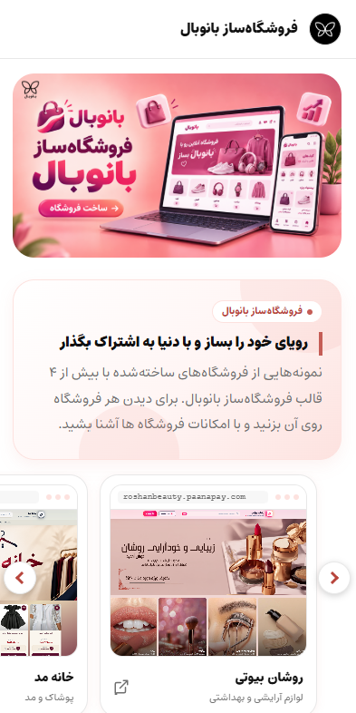

<div align="center">

# فروشگاه‌ساز بانوبال — لندینگ فروشگاه‌های نمونه

صفحه‌ی معرفی فروشگاه‌های نمونه‌ای که با فروشگاه‌ساز بانوبال ساخته شده‌اند.


</div>

## پیش‌نمایش

<p align="center">
  
  &nbsp;
  
</p>

## امکانات

- **بنر اصلی** با تصویر جداگانه برای موبایل و دسکتاپ
- **اسلایدر فروشگاه‌های نمونه** — دسکتاپ ۴ کارت، تبلت ۳ کارت، موبایل ۱ کارت؛ حرکت خودکار هر ۳ ثانیه و توقف با هاور یا لمس
- **حلقه‌ی چرخان محصولات** با دکمه‌ی «فروشگاهتو بساز» و انیمیشن ورود هنگام اسکرول
- **فوتر** با اطلاعات تماس، معرفی بانوبال و نماد اعتماد الکترونیکی (اینماد)
- **کاملاً راست‌چین و ریسپانسیو** (بر اساس Container Query)
- احترام به تنظیم «کاهش حرکت» (`prefers-reduced-motion`) سیستم کاربر
- فونت **Estedad** داخل خود پروژه (بدون وابستگی به سرویس بیرونی)

## اجرا

```bash
npm install
npm run dev       # اجرای محلی روی http://localhost:5173
npm run build     # ساخت نسخه‌ی نهایی در پوشه‌ی dist
npm run preview   # مشاهده‌ی نسخه‌ی ساخته‌شده
```

خروجی `dist` کاملاً استاتیک است و روی هر هاست یا CDN قابل انتشار است.

## ویرایش محتوا

تقریباً همه‌ی متن‌ها، لینک‌ها و فروشگاه‌ها در یک فایل هستند:

```
src/features/sample-stores/stores.config.js
```

| بخش | چه چیزی را تغییر می‌دهد |
|---|---|
| `BRAND` | متن‌های صفحه، لینک دکمه‌ها، اطلاعات تماس و فوتر |
| `STORES` | لیست فروشگاه‌های نمونه (نام، دسته، آدرس و عکس پیش‌نمایش) |
| `ENAMAD` | شناسه و کد اینماد |

برای افزودن فروشگاه جدید، عکس پیش‌نمایش را در `public/stores/` بگذارید و یک آیتم به `STORES` اضافه کنید.

**رنگ‌ها:** پالت رنگی بالای فایل `sample-stores.css` با متغیرهای `--ss-*` تعریف شده است.

## ساختار پروژه

```
src/
├── features/sample-stores/
│   ├── StoresPage.jsx       # صفحه‌ی اصلی
│   ├── PromoBanner.jsx      # بنر بالا
│   ├── StoresCarousel.jsx   # اسلایدر فروشگاه‌ها
│   ├── StoreCard.jsx        # کارت هر فروشگاه
│   ├── ProductRing.jsx      # حلقه‌ی چرخان محصولات
│   ├── Footer.jsx           # فوتر و اینماد
│   ├── stores.config.js     # محتوا و تنظیمات
│   └── sample-stores.css    # استایل‌ها
├── fonts/                   # فونت Estedad
└── index.css
public/                      # تصاویر (بنر، فروشگاه‌ها، اینماد، حلقه‌ی محصولات)
```

## لایسنس فونت

فونت [Estedad](https://github.com/aminabedi68/Estedad) تحت لایسنس SIL Open Font License 1.1 منتشر شده است.
